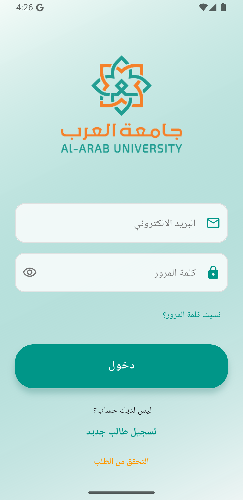
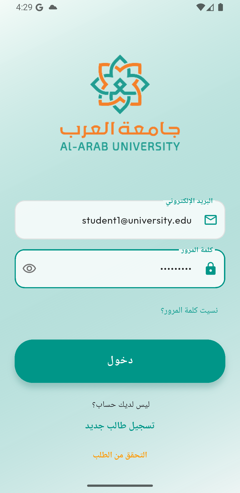

# Al-Arab Student Services

A full-stack university services platform built as a graduation project. Students manage their entire academic life from a single mobile app; university staff handle requests, payments, grades, and admissions from a Flutter Web dashboard; and a robust Laravel 12 API powers everything in between.

> **Graduation project · Team of 5 · Flutter + BLoC + Laravel 12 + PostgreSQL**

<p align="center">
  
  &nbsp;&nbsp;&nbsp;&nbsp;
  
</p>

---

## ✨ Features by Role

### 🎓 Student (Flutter mobile)
- Secure login with token-based authentication (Sanctum)
- View grades: coursework, midterm, final, total, GPA, letter estimate
- Browse study plan, semesters, and course schedules
- Submit service requests with file attachments (grade grievance, re-enrollment, suspension, etc.)
- Upload payment receipts and track approval status
- Appeal grade results and pay the appeal fee
- Read announcements, receive notifications, and complete surveys
- Arabic / English UI with real-time locale switching

### 👩‍💼 Student Affairs Officer (Admin Dashboard — Flutter Web)
- Review and approve / reject student service requests
- Send notifications to all students, by group, or individually
- Manage student applications and admissions
- View activity logs

### 💳 Accountant (Admin Dashboard — Flutter Web)
- Verify or reject uploaded payment receipts
- Process appeal payments
- View payment history and statistics

### 📊 Grade Control (Admin Dashboard — Flutter Web)
- Upload grades individually or via **Excel import** with smart column mapping
- Review and respond to grade appeal submissions
- Filter grades by program, course, and semester

### 🛠️ Admin (Admin Dashboard — Flutter Web)
- Full user management (create, update, reset passwords)
- Manage colleges, departments, programs, and courses
- Configure request types, semesters, and study schedules
- View comprehensive activity logs with filters

---

## 🏗️ Tech Stack

| Layer | Technology |
|---|---|
| Mobile app | Flutter 3, Dart, BLoC/Cubit |
| Admin dashboard | Flutter Web, BLoC/Cubit |
| Backend API | Laravel 12, PHP 8.2 |
| Database | PostgreSQL |
| Authentication | Laravel Sanctum |
| Authorization | Spatie Laravel Permission (RBAC) |
| Excel import | PhpSpreadsheet (smart column mapping) |
| Containerization | Docker via Laravel Sail |
| Testing | PHPUnit |
| API collection | Postman (see `docs/postman/`) |

---

## 📁 Project Structure

```
Student_ser/
└── Uni_App/
    ├── app/                        # Laravel — Controllers, Models, Services
    │   ├── Console/Commands/       # Artisan commands (including CreateAdminUser)
    │   ├── Http/                   # Controllers, Middleware, Requests
    │   ├── Models/                 # Eloquent models
    │   ├── Services/               # Business logic layer
    │   ├── Repositories/           # Repository pattern
    │   └── Policies/               # Authorization policies
    ├── database/
    │   ├── migrations/             # 68 ordered migration files
    │   ├── seeders/                # Role, university, sample data seeders
    │   └── schema_backup/          # PostgreSQL schema snapshot
    ├── routes/
    │   └── api.php                 # All API routes (student + staff + admin)
    ├── tests/                      # PHPUnit feature & unit tests
    ├── admin_dashboard/            # Flutter Web admin app
    │   └── lib/
    │       ├── core/               # API client, constants, router, theme
    │       └── features/           # Screen-level feature modules
    ├── student_portal/             # Flutter mobile student app
    │   └── lib/
    │       ├── core/               # API client, constants, BLoC, theme
    │       └── features/           # Auth, grades, requests, payments, surveys…
    ├── docs/                       # API documentation and guides
    │   ├── api_documentation.md
    │   ├── API_TESTING_GUIDE.md
    │   ├── schema_documentation.md
    │   ├── walkthrough.md
    │   ├── screenshots/            # App preview screenshots
    │   └── postman/                # Postman collection files
    └── grades_upload_sample.csv    # Sample file for Excel grade import
```

---

## 🚀 Setup

### Prerequisites
- PHP 8.2+ and Composer
- PostgreSQL 14+
- Flutter 3.x SDK
- Docker Desktop (optional, for Sail)

---

### Backend (Laravel API)

```bash
cd Uni_App

# 1. Install dependencies
composer install

# 2. Copy and configure environment
cp .env.example .env
# Edit .env:  DB_DATABASE, DB_USERNAME, DB_PASSWORD, ADMIN_SEED_PASSWORD

# 3. Generate application key
php artisan key:generate

# 4. Run migrations and seed
php artisan migrate --seed

# 5. Start the development server
php artisan serve
```

**With Docker (recommended):**
```bash
./vendor/bin/sail up -d
./vendor/bin/sail artisan key:generate
./vendor/bin/sail artisan migrate --seed
```

**Default seeded accounts** (passwords set via `ADMIN_SEED_PASSWORD` in `.env`):

| Role | Email |
|---|---|
| Admin | admin@university.edu |
| Student Affairs | affairs@university.edu |
| Accountant | accountant@university.edu |
| Grade Control | grades@university.edu |

> ⚠️ **Change `ADMIN_SEED_PASSWORD` before seeding in any shared or production environment.**

---

### Admin Dashboard (Flutter Web)

```bash
cd Uni_App/admin_dashboard
flutter pub get

# Point to your local API (edit lib/core/constants/api_constants.dart if needed)
flutter run -d chrome
```

---

### Student Portal (Flutter Mobile)

```bash
cd Uni_App/student_portal
flutter pub get

# Android emulator: baseUrl defaults to http://10.0.2.2:8000/api
# iOS Simulator / Web: change baseUrl in lib/core/constants/api_constants.dart
flutter run
```

---

## 📖 Documentation

| Document | Description |
|---|---|
| [`docs/api_documentation.md`](Uni_App/docs/api_documentation.md) | Full API endpoint reference |
| [`docs/API_TESTING_GUIDE.md`](Uni_App/docs/API_TESTING_GUIDE.md) | Step-by-step Postman testing guide |
| [`docs/schema_documentation.md`](Uni_App/docs/schema_documentation.md) | Database schema overview |
| [`docs/walkthrough.md`](Uni_App/docs/walkthrough.md) | Feature walkthrough |
| [`docs/screenshots/`](Uni_App/docs/screenshots/) | Mobile student app preview screenshots |
| [`docs/postman/`](Uni_App/docs/postman/) | Postman collection files |
| [`grades_upload_sample.csv`](Uni_App/grades_upload_sample.csv) | Sample CSV for Excel grade import |

---

## 👥 Team

| Name | GitHub |
|---|---|
| Amani Rabeea | [@Amani20f](https://github.com/Amani20f) |
| Noor Abdullah Bamatraf | [@noorbam](https://github.com/noorbam) |
| Nora Omar | — |
| Hanan Omar | — |
| Raghad Akram | — |
